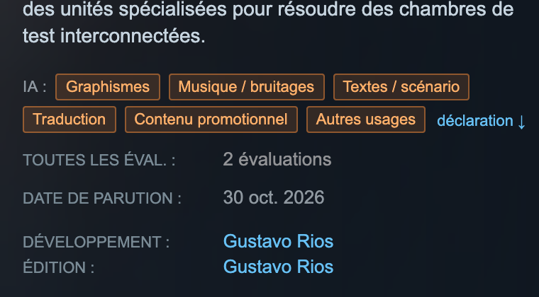

[English](README.md) · **Français**

# Mes scripts Violentmonkey

Collection personnelle de userscripts pour [Violentmonkey](https://violentmonkey.github.io/) (compatibles Tampermonkey). Un dossier par script, avec un README détaillé et des captures d'écran.

Site : **https://jamesdadams.github.io/my-violentmonkey-scripts/**

## Scripts

| Script | En bref |
| --- | --- |
| [**Steam — Déclaration IA**](steam-declaration-ia/) | Ajoute sur les fiches Steam une ligne « IA » listant les usages d'IA générative déclarés par le développeur (graphismes, voix, traduction, code, IA en jeu…). Sur le reste du magasin (accueil, recherche, tags, promotions), pose un bandeau **IA** sur les vignettes des jeux concernés, avec les usages en infobulle. Interface en français ou en anglais selon le navigateur.   |
