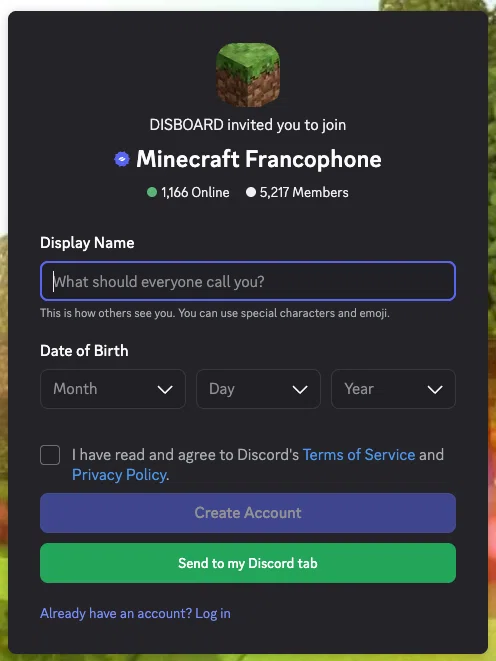
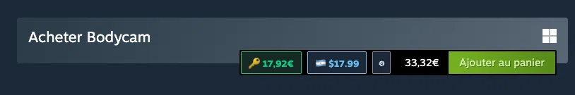

**English** · [Français](README.fr.md)

# My Violentmonkey scripts

Personal collection of userscripts for [Violentmonkey](https://violentmonkey.github.io/) (also compatible with Tampermonkey). One folder per script, each with a detailed README and screenshots.

Website: **https://script.jamesserver.fr/**

## Scripts

| Script | What it does | Installation |
| --- | --- | --- |
| [**Steam — AI disclosure**](steam-declaration-ia/) | Adds an “AI” row on Steam game pages, listing the generative-AI uses the developer declares (graphics, voices, translation, code, in-game AI…). On the rest of the store (home, search, tags, sales), puts an **AI** badge on the thumbnails of games with a disclosure, with the declared uses in the tooltip. UI in French or English depending on the browser.   |  |
| [**Discord — Invite to open tab**](discord-invite-tab/) | On a Discord invite page, sends the invite to the Discord tab you already have open instead of loading Discord in the current page: one button under “Create Account”, no network request.   |  |
| [**Steam — Region + key price**](steam-region-price/) | Two badges on the Steam purchase box: the store price of any country you pick, and the cheapest key price from GG.deals. The API key and both regions are set once, in a dialog on the site.   |  |
