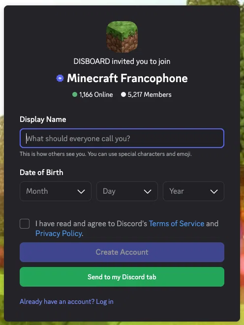

**Français** · [English](README.md)

# Discord Web Invite — Ouvrir dans l'onglet existant

Cliquez sur le bouton vert d'une page d'invitation Discord : l'invitation part vers l'onglet Discord déjà ouvert dans votre navigateur — pas de seconde session, pas d'écran de connexion.

## Aperçu

## Installation

## Ce qu'il ajoute

Sur `discord.com/invite/…` et `discord.gg/…`, un bouton **« Envoyer vers mon onglet Discord »** — ou **“Send to my Discord tab”** selon la langue du navigateur — apparaît juste sous le bouton « Create Account ».

En cliquant dessus :

1. le bouton affiche **« Envoi vers ton onglet Discord… »** et le code part par **trois canaux en parallèle** — un `BroadcastChannel`, une écriture `localStorage` sur la même origine et le stockage du gestionnaire (`GM_setValue`) — pour passer même si l'un d'eux est indisponible ;
2. l'onglet Discord déjà ouvert le reçoit **instantanément, même en arrière-plan** (un évènement `storage` et un message `BroadcastChannel` ne sont pas bridés comme les minuteurs), dépose un accusé de réception puis navigue vers `/invite/{code}` ;
3. le bouton passe à **« Envoyé ! Retourne sur ton onglet Discord »**.

Discord affiche son écran « rejoindre le serveur », déjà connecté. Aucune requête réseau en dehors de Discord, pas de seconde session, pas d'écran de connexion.

**Si aucun onglet Discord ne répond en 5 s** (aucun ouvert, ou onglet chargé avant l'installation du script), l'invitation s'ouvre **dans un nouvel onglet** et le bouton l'indique — le clic fait donc toujours quelque chose.

> Après l'installation ou une mise à jour, rechargez une fois l'onglet où Discord est déjà ouvert : un onglet chargé avant l'installation n'exécute pas encore la nouvelle version.

## Limites

- Le script ne fonctionne que sur `discord.com` et `discord.gg`.
- L'invitation est conservée 3 minutes : une invitation envoyée sans onglet Discord ouvert est ignorée.
- Si Discord change son bloc de connexion, un rafraîchissement de la page peut être nécessaire pour voir le bouton.

## Vie privée

Tout reste dans votre navigateur : le code d'invitation est écrit dans le stockage du gestionnaire (`GM_setValue`), lu une fois par votre onglet Discord puis effacé. Aucun serveur externe, aucune analyse.

---

Site : <https://script.jamesserver.fr/#discord-invite-tab>
