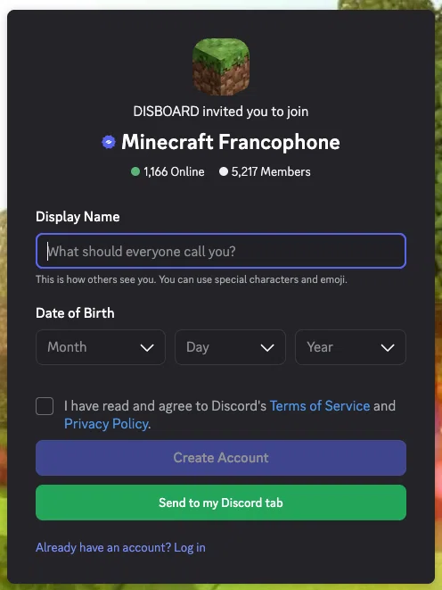

**English** · [Français](README.fr.md)

# Discord Web Invite — Open in existing tab

Click the green button on a Discord invite page and the invite is sent to the Discord tab already open in your browser — no second Discord session, no login screen.

## Preview

## Install

## What it adds

On `discord.com/invite/…` and `discord.gg/…`, a button **“Send to my Discord tab”** — or **« Envoyer vers mon onglet Discord »** depending on the browser language — appears right under the “Create Account” submit button.

Clicking it:

1. shows **“Sending to your Discord tab…”** and sends the invite code through **three channels at once** — a `BroadcastChannel`, a `localStorage` write on the same origin, and the userscript storage (`GM_setValue`);
2. the Discord tab you already have open receives it **instantly, even in the background** (a `storage` event or a channel message is not throttled like a timer); it acknowledges, clears the value and navigates to `/invite/{code}`;
3. the button turns **“Sent! Go back to your Discord tab”**.

If no tab answers within 5 s, the button switches to **“Switch to your Discord tab: the invite will open there”** and the invitation stays pending: the Discord tab opens it **as soon as you activate it** (or reload it), and the button then turns to “Sent!”. A small **“open in a new tab”** link is offered as a last resort — no tab is opened behind your back.

> After installing or updating the script, reload the tab where Discord is already open once: a tab loaded before the installation does not run the new version yet.

Open the browser console on both tabs to follow what happens: `[Discord invite]` messages.

## Limits

- The script only works on `discord.com` and `discord.gg`.
- The invite is stored for 3 minutes: an invitation sent while no Discord tab is open is ignored.
- If the Discord page changes its account block, the button may need a page refresh to appear.

## Privacy

Everything stays in your browser: the invite code is written to the userscript storage (`GM_setValue`), read once by your Discord tab and cleared. No external server, no analytics.

---

Website: <https://script.jamesserver.fr/#discord-invite-tab>
