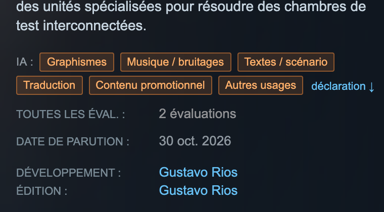
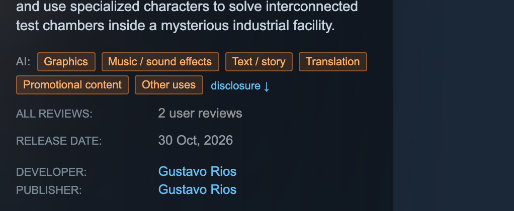
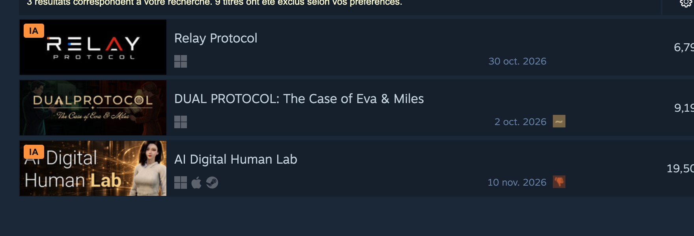

[English](README.md) · **Français**

# Steam — Déclaration IA

Userscript qui rend visible, sur le magasin Steam, ce que les développeurs déclarent utiliser comme **IA générative** — d'après la section « AI Generated Content Disclosure » / « Notification de contenu généré par IA » de chaque fiche.

Pas de compte, pas de service tiers, pas de télémétrie : tout est lu dans la page et mis en cache localement.

## Aperçu

**Sur une fiche de jeu** — une ligne « IA » en tête de l'encart *glance*, un tag par usage déclaré, l'extrait au survol, le saut à la déclaration au clic. L'interface suit la langue du navigateur :

| Français | English |
| --- | --- |
|  |  |

**Sur les listes** (accueil, recherche, tags, promotions) — un bandeau **IA** sur les vignettes concernées, avec les usages déclarés en infobulle :

| Dans une liste | Gros plan |
| --- | --- |
|  |  |

## Installation

[**Installer le script**](https://raw.githubusercontent.com/JamesDAdams/my-violentmonkey-scripts/main/steam-declaration-ia/steam-declaration-ia.user.js) — ou copier [`steam-declaration-ia.user.js`](steam-declaration-ia.user.js) dans Violentmonkey.

Champs de l'en-tête :

```js
// @match     https://store.steampowered.com/*
// @run-at    document-idle
// @inject-into content
// @grant     none
```

## Ce que fait le script

### Sur une fiche (`/app/…`)

Le script repère la section de déclaration, en extrait le texte et le classe dans **10 catégories** :

| Catégorie | Exemples de mots-clés reconnus |
| --- | --- |
| Graphismes | artwork, illustrations, textures, sprites, 3D models |
| Animation / vidéo | animations, cinematics, cutscenes, mocap |
| Musique / bruitages | music, soundtrack, sound effects, SFX |
| Voix | voices, voice-over, TTS, doublage |
| Textes / scénario | texts, story, dialogues, writing |
| Traduction | translation, localization, DeepL |
| Code | code, programming, scripting, Copilot |
| Contenu promotionnel | capsule art, key art, marketing, trailer |
| IA pendant la partie | runtime, real-time, live generation, in-game |
| Autres usages | concept art, brainstorming, references, testing |

Chaque mention prend un **état** :

- **Usage déclaré** — le développeur dit l'utiliser ;
- **Déclaré absent** — « no AI », « aucun », « sans »… ;
- **Retiré** — « has been replaced by human… » ;
- **À préciser / À vérifier** — « may », « plan to use », mentions contradictoires.

Le texte du développeur reste accessible (infobulle + lien `déclaration ↓`).

### Sur les listes

Un bandeau **IA** (orange) sur la vignette de chaque jeu dont la fiche contient une déclaration. Les usages s'affichent au survol. La taille du bandeau s'adapte à la vignette (grand format sur les grilles, compact sur les lignes de recherche).

### Langues

L'interface suit `navigator.language` : `fr*` → français, sinon anglais. La **lecture** est indépendante : le script reconnaît les titres et les textes de déclaration en français comme en anglais, donc un navigateur anglais sur une fiche française fonctionne normalement.

## Réseau et vie privée

Le statut « ce jeu déclare-t-il de l'IA ? » n'est disponible que sur la fiche du jeu : le script la télécharge donc à la demande, uniquement pour les vignettes visibles.

| | |
| --- | --- |
| Requête | `GET https://store.steampowered.com/app/{id}/?l=french` (même origine, ~25 Ko compressés) |
| Fréquence | 1 à la fois, 800 ms d'écart, **30 requêtes/min max**, **80 par page vue** |
| Cache | `localStorage` → 30 jours ; statut illisible (contrôle d'âge, 404) → 3 jours |
| Erreur / HTTP 429 | pause automatique de 10 minutes |
| Tiers | aucun : pas d'appel vers un autre domaine, aucun cookie exporté |

Visiter une fiche amorce le cache : le bandeau apparaît ensuite instantanément sur les listes, sans requête.

## Limites connues

- **Classification heuristique** : les regex font un tri raisonnable, pas une compréhension. Exemple : « voice acting was recorded by humans » peut ressortir en « Voix : usage déclaré » ; le texte du développeur est affiché pour trancher.
- **Contrôle d'âge** : si Steam masque la fiche, le statut reste inconnu (aucun bandeau) plutôt que d'être deviné.
- **Jeux plus bas dans la page** : les badges arrivent progressivement (1 toutes les ~800 ms, plafond 80 par page). Un rechargement reprend là où le cache n'a pas encore la réponse.
- **Langues** : seuls les titres FR et EN sont reconnus ; sur une fiche allemande ou espagnole, le script conclura à l'absence de déclaration.
- Le bandeau n'est posé que sur les vignettes **≥ 60 × 60 px** (pour éviter les logos).

## Détails techniques

- **Cible de la ligne** : `#glanceMidCtn .glance_ctn_responsive_left`, sinon `.glance_ctn_responsive_left`, sinon `#glanceMidCtn` (préfixé en tête de bloc).
- **Vignettes** : `a[href*="/app/"]`, `[data-ds-appid]`, `[data-appid]` contenant une image ; le plus grand `img` du conteneur sert d'ancre au bandeau.
- **Cache** : clé `centuIA/status/v2` (`{ h: 0|1, c: [ids…], t, u? }`), les catégories sont stockées en identifiants pour rester indépendantes de la langue.
- **Réglages** en tête de fichier : `RATE_MAX`, `RATE_WINDOW`, `MAX_PAGE`, `GAP`, `TTL`, `TTL_UNKNOWN`.
- Le style est injecté une fois (`#centu-ia-style`) ; en cas de rechargement partiel de Steam, le nœud est réinséré automatiquement.

## Compatibilité

Chrome / Edge / Firefox avec Violentmonkey (testé sur Chrome 150, magasin Steam FR et EN). Le script ne dépend d'aucune API GM (`@grant none`), donc il fonctionne aussi dans Tampermonkey.
