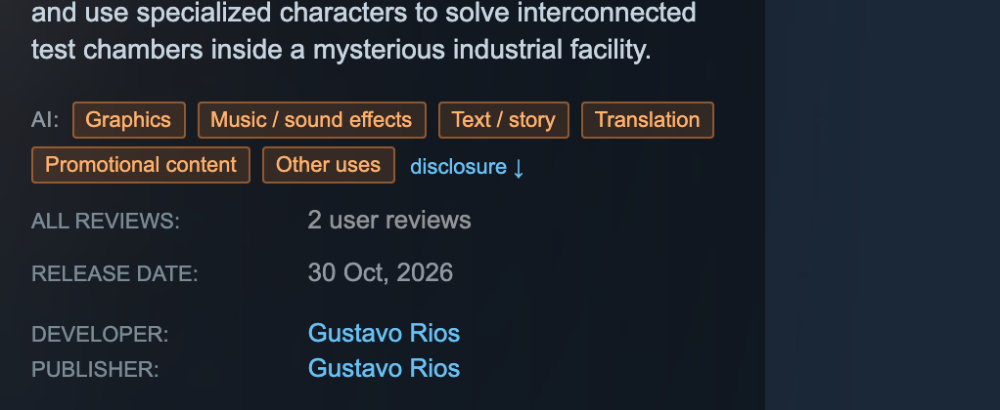
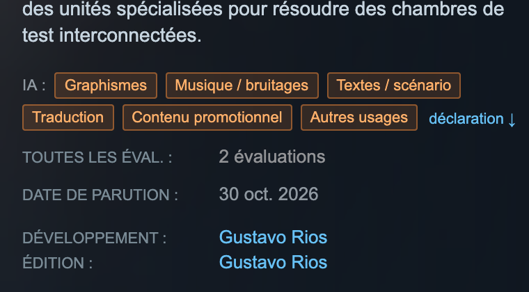
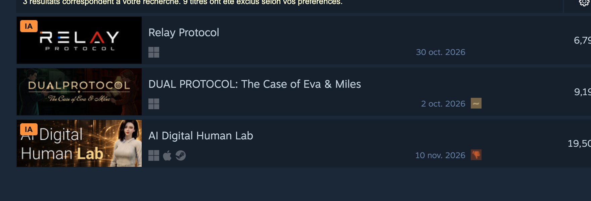
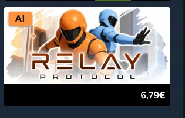

**English** · [Français](README.fr.md)

# Steam — AI disclosure

Userscript that surfaces, on the Steam store, what developers declare using **generative AI** — based on the “AI Generated Content Disclosure” section of each store page.

No account, no third-party service, no telemetry: everything is read from the page and cached locally.

## Preview

**On a game page** — an “AI” row at the top of the *glance* box, one tag per declared use, the excerpt on hover, jump to the disclosure on click. The UI follows the browser language:

| English | Français |
| --- | --- |
|  |  |

**On listings** (home, search, tags, sales) — an **AI** badge on the matching thumbnails, with the declared uses in the tooltip:

| In a list | Close-up |
| --- | --- |
|  |  |

## Installation

[**Install the script**](https://raw.githubusercontent.com/JamesDAdams/my-violentmonkey-scripts/main/steam-declaration-ia/steam-declaration-ia.user.js) — or copy [`steam-declaration-ia.user.js`](steam-declaration-ia.user.js) into Violentmonkey.

Header fields:

```js
// @match     https://store.steampowered.com/*
// @run-at    document-idle
// @inject-into content
// @grant     none
```

## What it does

### On a game page (`/app/…`)

The script finds the disclosure section, extracts its text and classifies it into **10 categories**:

| Category | Examples of recognized keywords |
| --- | --- |
| Graphics | artwork, illustrations, textures, sprites, 3D models |
| Animation / video | animations, cinematics, cutscenes, mocap |
| Music / sound effects | music, soundtrack, sound effects, SFX |
| Voices | voices, voice-over, TTS, dubbing |
| Text / story | texts, story, dialogues, writing |
| Translation | translation, localization, DeepL |
| Code | code, programming, scripting, Copilot |
| Promotional content | capsule art, key art, marketing, trailer |
| AI during gameplay | runtime, real-time, live generation, in-game |
| Other uses | concept art, brainstorming, references, testing |

Each mention gets a **state**:

- **Declared use** — the developer says they use it;
- **Declared unused** — “no AI”, “none”, “without”…;
- **Removed** — “has been replaced by human…”;
- **Needs clarification / Mentions to check** — “may”, “plan to use”, contradictory statements.

The developer’s text stays available (tooltip + `disclosure ↓` link).

### On listings

An orange **AI** badge on the thumbnail of every game whose page contains a disclosure. Uses appear on hover. The badge scales with the thumbnail (large on grids, compact on search rows).

### Languages

The UI follows `navigator.language`: `fr*` → French, otherwise English. **Parsing** is independent: the script recognizes both French and English headings and disclosure texts, so an English browser on a French page works normally.

## Network and privacy

The status “does this game declare AI?” is only available on the game page: the script therefore downloads it on demand, only for visible thumbnails.

| | |
| --- | --- |
| Request | `GET https://store.steampowered.com/app/{id}/?l=french` (same origin, ~25 KB compressed) |
| Rate | one at a time, 800 ms apart, **max 30 requests/min**, **80 per page view** |
| Cache | `localStorage` → 30 days; unreadable status (age check, 404) → 3 days |
| Error / HTTP 429 | automatic 10-minute pause |
| Third parties | none: no call to another domain, no cookie exported |

Visiting a game page seeds the cache: the badge then appears instantly on listings, with no request.

## Known limitations

- **Heuristic classification**: the regexes do a reasonable sort, not real understanding. Example: “voice acting was recorded by humans” can come out as “Voices: declared use”; the developer’s text is displayed so you can judge.
- **Age check**: if Steam hides the page, the status stays unknown (no badge) instead of being guessed.
- **Games further down a page**: badges arrive progressively (one every ~800 ms, 80 per page max). A reload resumes where the cache has no answer yet.
- **Languages**: only FR and EN headings are recognized; on a German or Spanish page the script will conclude there is no disclosure.
- The badge is only placed on thumbnails **≥ 60 × 60 px** (to skip logos).

## Technical details

- **Row target**: `#glanceMidCtn .glance_ctn_responsive_left`, otherwise `.glance_ctn_responsive_left`, otherwise `#glanceMidCtn` (prepended to the block).
- **Thumbnails**: `a[href*="/app/"]`, `[data-ds-appid]`, `[data-appid]` containing an image; the largest `img` in the container is used as the badge anchor.
- **Cache**: key `centuIA/status/v2` (`{ h: 0|1, c: [ids…], t, u? }`), categories are stored as identifiers so they stay language-independent.
- **Settings** at the top of the file: `RATE_MAX`, `RATE_WINDOW`, `MAX_PAGE`, `GAP`, `TTL`, `TTL_UNKNOWN`.
- The style is injected once (`#centu-ia-style`); if Steam partially re-renders, the node is re-inserted automatically.

## Compatibility

Chrome / Edge / Firefox with Violentmonkey (tested on Chrome 150, Steam store FR and EN). The script depends on no GM API (`@grant none`), so it also works in Tampermonkey.
