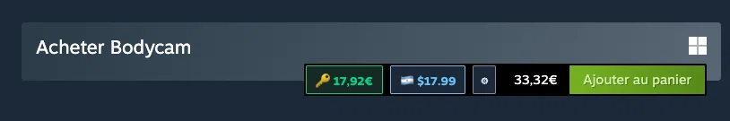

[English](README.md) · **Français**

# Steam — Prix de la région + prix des clés (GG.deals)

Deux badges sur l'encart d'achat d'une fiche Steam :

- 🌍 le **prix Steam dans le pays de votre choix** (API de la boutique, `cc=<pays>`), avec un lien vers SteamDB ;
- 🔑 le **prix clé le moins cher** sur GG.deals, avec un lien vers la fiche du jeu sur GG.deals.

Les lignes de DLC reçoivent les deux mêmes badges.




## Installation

[](https://raw.githubusercontent.com/JamesDAdams/my-violentmonkey-scripts/main/steam-region-price/steam-region-price.user.js)

## Réglages

Tout se règle **dans le script**, sur une fiche de jeu Steam : un panneau de réglages s'ouvre automatiquement au premier lancement, et le badge **⚙** à côté des badges de prix le rouvre à tout moment.

| Champ | Ce que c'est | Exemple |
| --- | --- | --- |
| **Clé API** | votre clé GG.deals gratuite ([gg.deals/api](https://gg.deals/api/)) — obligatoire si « Prix des clés » est actif | `AbCdEf123456` |
| **Région GG.deals** | pays/région utilisé pour le **prix des clés** (devise) | France `fr` |
| **Région Steam** | pays dont on veut voir le **prix Steam** | Argentine `ar`, Turquie `tr`, États-Unis `us`… |
| **Prix Steam / Prix des clés** | afficher ou masquer chaque badge | les deux |

Les deux parties se désactivent indépendamment, **mais pas les deux en même temps** : sans aucune des deux le script n'afficherait rien, donc le panneau refuse d'enregistrer.

Le panneau enregistre les valeurs avec `GM_setValue`, sur votre machine — rien n'est envoyé à un serveur, la clé ne quitte jamais votre ordinateur.

Vous pouvez aussi modifier les constantes en tête du fichier :

```js
const GG_DEALS_API_KEY = 'VOTRE_CLE_API_ICI';
const GG_DEALS_REGION = 'fr';
const STEAM_REGION = 'ar';
const SHOW_STEAM_REGION = true;
const SHOW_GGDEALS = true;
```

Sans clé API, le badge des clés affiche « Clé API requise » et ouvre le panneau de réglages ; le badge de prix Steam continue de fonctionner.

## Fonctionnement

- Prix Steam : `GM_xmlhttpRequest` vers `store.steampowered.com/api/{appdetails|packagedetails}?cc=<région Steam>` pour chaque option d'achat (`input[name=subid]`) et chaque ligne de DLC.
- Prix des clés : `api.gg.deals/v1/prices/by-steam-app-id` avec votre clé et `region=<région GG.deals>`, puis le plus bas entre boutiques de clés et prix revendeur.
- Les badges sont insérés au début de `.game_purchase_action_bg` et `.game_area_dlc_price` ; les démos (`demo_above_purchase`) sont ignorées.
- Les libellés suivent la langue du navigateur (français ou anglais) ; le drapeau et le nom du pays sont déduits du code ISO.

## Limites

- L'API GG.deals est limitée en débit sur l'offre gratuite : il arrive qu'un prix affiche « Erreur API ».
- Un jeu sans clé disponible affiche « Aucune clé ».
- Le prix `cc=` est celui de la boutique pour ce pays ; il ne tient pas compte des restrictions de paiement régionales.

## Vie privée

Votre clé API reste dans le script, sur votre machine. Les seuls appels réseau vont à `store.steampowered.com` et `api.gg.deals` — aucun autre domaine, aucune analyse.
