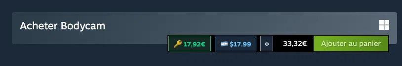

**English** · [Français](README.fr.md)

# Steam — Region price + key price (GG.deals)

Two badges on the purchase box of a Steam game page:

- 🌍 the **Steam price in the country you choose** (store API, `cc=<country>`), linking to SteamDB;
- 🔑 the **cheapest key price** on GG.deals, linking to the GG.deals page of the game.

DLC rows get the same two badges.




## Install

[](https://raw.githubusercontent.com/JamesDAdams/my-violentmonkey-scripts/main/steam-region-price/steam-region-price.user.js)

## Settings

Everything is configured **inside the script**, on a Steam game page: a settings panel opens automatically the first time, and the **⚙** badge next to the price badges reopens it at any time.

| Field | What it is | Example |
| --- | --- | --- |
| **API key** | your free GG.deals key ([gg.deals/api](https://gg.deals/api/)) — required when “Key price” is on | `AbCdEf123456` |
| **GG.deals region** | country/region used for **key** prices (currency) | France `fr` |
| **Steam region** | country whose **Steam** price you want to see | Argentina `ar`, Turkey `tr`, US `us`… |
| **Steam price / Key price** | show or hide each badge | both on |

Both sections can be turned off independently, **but not at the same time**: with both disabled the script would show nothing, so the panel refuses to save.

The panel stores the values with `GM_setValue`, on your machine — nothing is sent to a server, and the key never leaves your computer.

You can also edit the constants at the top of the file instead:

```js
const GG_DEALS_API_KEY = 'VOTRE_CLE_API_ICI';
const GG_DEALS_REGION = 'fr';
const STEAM_REGION = 'ar';
const SHOW_STEAM_REGION = true;
const SHOW_GGDEALS = true;
```

Without an API key the key badge shows “Clé API requise” / “API key required” and opens the settings panel; the Steam price badge keeps working.

## How it works

- Steam price: `GM_xmlhttpRequest` to `store.steampowered.com/api/{appdetails|packagedetails}?cc=<STEAM_REGION>` for each purchase option (`input[name=subid]`) and each DLC row.
- Key price: `api.gg.deals/v1/prices/by-steam-app-id` with your key and `region=<GG_DEALS_REGION>`, then the lower of keyshop / retail price.
- Badges are inserted at the start of `.game_purchase_action_bg` and `.game_area_dlc_price`; demos (`demo_above_purchase`) are skipped.
- UI strings follow the browser language (French or English); the flag and country name are derived from the ISO code.

## Limits

- The GG.deals API is rate-limited on the free plan: prices may occasionally show “API error”.
- A game with no key available shows “Aucune clé” / “No keys”.
- Steam's `cc=` price is the store price for that country; it does not include regional payment restrictions.

## Privacy

Your API key lives in the script, on your machine. The only network calls are to `store.steampowered.com` and `api.gg.deals` — no other domain, no analytics.
